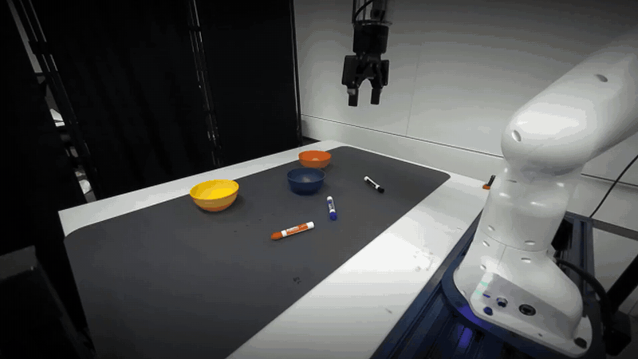

<div align="center">

# FoveaVLA: Foveation Actions<br>Replace the Wrist Camera in VLAs

[Bingao Chen](https://bingaochen.github.io/)<sup>1</sup>, [Lihan Zha](https://lihzha.github.io/)<sup>2</sup>, [C. Karen Liu](https://profiles.stanford.edu/c-karen-liu)<sup>1,†</sup>, [Guy Tevet](https://guytevet.github.io/)<sup>1,†</sup>

<sup>1</sup>Stanford University &nbsp;&nbsp; <sup>2</sup>Princeton University &nbsp;&nbsp; <sup>†</sup>Equal advising

[](https://arxiv.org/abs/2610.20064)
[](https://tml.stanford.edu/FoveaVLA/)
[](https://huggingface.co/collections/bingaochen/foveavla)
[](LICENSE)

</div>

<p align="center">
  <a href="https://tml.stanford.edu/FoveaVLA/"></a>
</p>

**FoveaVLA** is a π₀.₅-based vision-language-action model that replaces the wrist camera with a learned **foveation action**. Alongside every action chunk, it predicts a box around the region where the next interaction will happen, such as the gripper, the object, and the target. At the next policy query, that region is cropped from the original-resolution external image and given to the policy together with the full view, so the policy gets close-up detail without a camera on the hand.

This repository provides pretrained models, data preparation, training, and real-robot deployment:

| Model | Config | External cameras | RGB-D inputs |
|---|---|---|---|
| [FoveaVLA-Single](https://huggingface.co/bingaochen/FoveaVLA-Single) | `foveavla_single` | One ZED | Full view + foveal crop |
| [FoveaVLA-Dual](https://huggingface.co/bingaochen/FoveaVLA-Dual) | `foveavla_dual` | Two ZEDs | Full view + foveal crop per camera |

## Installation

Use Linux, Python 3.11, an NVIDIA GPU, and [uv](https://docs.astral.sh/uv/). Clone the repository and install the server environment:

```bash
git clone https://github.com/Stanford-TML/FoveaVLA.git
cd FoveaVLA
uv venv --python 3.11
uv sync --locked
scripts/setup_fast_foundation_depth.sh
```

The server environment takes about 8 GB of disk, and each pretrained checkpoint about 12.4 GB. Serving a model uses about 13 GB of GPU memory.

## Deployment

On the GPU server, download a pretrained model and start the policy server:

```bash
MODEL=foveavla_single  # Or foveavla_dual.
uv run scripts/download_checkpoint.py --model="$MODEL"
XLA_PYTHON_CLIENT_MEM_FRACTION=0.70 uv run scripts/serve.py --model="$MODEL"
```

On the camera workstation, set up the DROID client in its own Python 3.10 environment, separate from the server environment (see [deployment](docs/deployment.md#2-set-up-the-robot-client)). The workstation can be the GPU server itself. Then start the client:

```bash
LD_LIBRARY_PATH=/usr/local/zed/lib${LD_LIBRARY_PATH:+:$LD_LIBRARY_PATH} \
  python examples/droid/main.py \
  --left-camera-id=YOUR_LEFT_ZED_SERIAL \
  --instruction="pick up the object" \
  --remote-host=SERVER_IP --remote-port=8000
```

Replace the camera serial, task instruction, and `SERVER_IP`. The client resets the robot and starts the rollout. Press Ctrl+C to stop. Add `--debug` to save a debug video, foveal crops, and a log under `outputs/rollouts/`.

For Dual, set `MODEL=foveavla_dual` on the server and add `--right-camera-id=YOUR_RIGHT_ZED_SERIAL` to the client. Assign the two external cameras in physical-left then physical-right order.

See [deployment](docs/deployment.md) for checkpoint paths and client options.

## Training

FoveaVLA is post-trained from the π₀.₅ base checkpoint on the external cameras of [DROID](https://droid-dataset.github.io/), with foveation supervised by [RoboInter](https://github.com/InternRobotics/RoboInter) interaction boxes. Follow [data preparation](docs/data.md) to build the boxes, foveal crops, and depth, then train:

```bash
uv sync --locked --group rlds
MODEL=foveavla_single  # Or foveavla_dual.
export FOVEAVLA_DATA_ROOT=/path/to/data/processed/$MODEL
export FOVEAVLA_RLDS_DIR=/path/to/data/rlds
export WANDB_API_KEY="YOUR_WANDB_API_KEY"

uv run --no-sync scripts/train.py "$MODEL" --exp-name=my_run
```

Training uses the π₀.₅ base checkpoint's DROID normalization statistics and downloads them with the base weights on the first run. The default configuration uses 8 GPUs and logs to W&B. Replace `YOUR_WANDB_API_KEY` with your [W&B API key](https://wandb.ai/authorize). See [training](docs/training.md) for GPU settings, data paths, and resuming a run.

## Acknowledgements and license

Built on [OpenPI](https://github.com/Physical-Intelligence/openpi), using [DROID](https://droid-dataset.github.io/droid/the-droid-dataset.html), [RoboInter](https://github.com/InternRobotics/RoboInter), and [Fast-FoundationStereo](https://github.com/NVlabs/Fast-FoundationStereo).

The code is released under [Apache-2.0](LICENSE). See [NOTICE](NOTICE) and [Gemma notices](LICENSE_GEMMA.txt) for source attribution.

## Citation

```bibtex
@misc{chen2026foveavla,
  title         = {FoveaVLA: Foveation Actions Replace the Wrist Camera in VLAs},
  author        = {Bingao Chen and Lihan Zha and C. Karen Liu and Guy Tevet},
  year          = {2026},
  eprint        = {2610.20064},
  archivePrefix = {arXiv},
  primaryClass  = {cs.RO},
  url           = {https://arxiv.org/abs/2610.20064}
}
```
